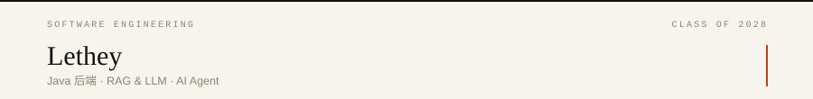

<!-- GitHub 个人主页 README
     上传：新建与用户名同名的 public 仓库 → 粘贴本文件 → 再上传 banner.svg 和 banner-dark.svg
     内容来源：个人简历（实习经历按要求未收录） -->

<picture>
  <source media="(prefers-color-scheme: dark)" srcset="./banner-dark.svg">
  
</picture>

<picture>
  <source media="(prefers-color-scheme: dark)" srcset="https://readme-typing-svg.demolab.com?font=Fira+Code&weight=600&size=18&pause=1000&color=58A6FF&center=true&vCenter=true&width=520&height=40&lines=Java+Backend+Developer;RAG+%26+LLM+Applications;AI+Agent+Full-Stack">
  
</picture>

## ABOUT ME

🎓 **集美大学** ｜ 软件工程 ｜ 2024.09 – 2028.06 ｜ GPA **4.33/5**（专业 1/128）｜ CET-6

🏆 **竞赛与荣誉**

- `奖学金` ：2026 年国家奖学金
- `天梯赛` ：第十一届团体程序设计天梯赛 全国总决赛一等奖
- `蓝桥杯` ：第十七届 Java 程序设计 全国总决赛一等奖
- `CCPC` ：2026 全国邀请赛 · 福州站 银奖
- `ICPC` ：2026 全国邀请赛 · 武汉站 铜奖

📫 **联系我**

- 📮 E-mail ：`15805923629@163.com`
- 🧩 LeetCode ：

---

**🛠 技术栈**

    

    

    

---

